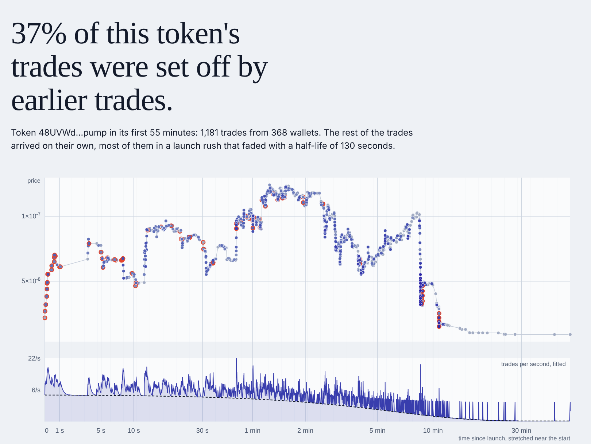
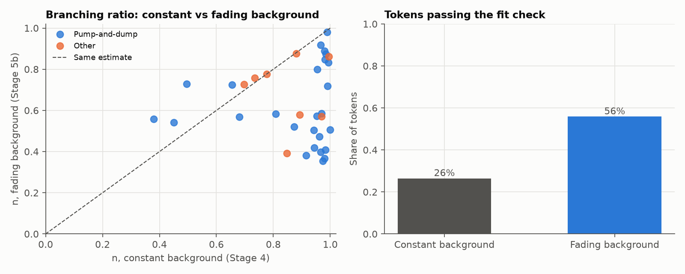
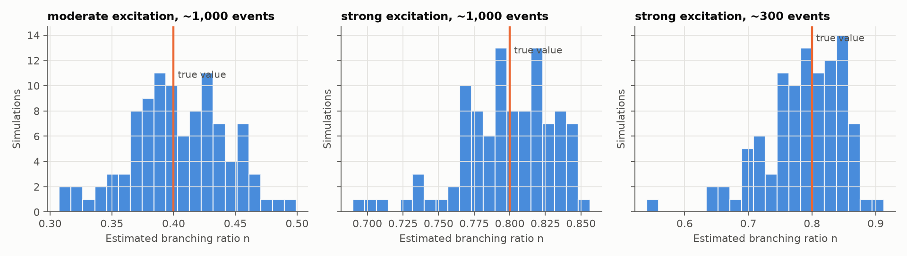

# meme-hawkes

**Do coordinated wallets set off ordinary buyers? Self-exciting point processes on wallet-level pump.fun trade data.**

**[Open the live app →](https://meme-hawkes.streamlit.app/)** Paste any new pump.fun token and see how much of its first hour of trading was trades setting off more trades.

[](https://meme-hawkes.streamlit.app/)

24-hour build #4 by [sanjayashokbuilds](https://github.com/sanjayashokbuilds). Research on public blockchain data, not trading advice.

---

## In one paragraph
On pump.fun, anyone can launch a memecoin in seconds, and every trade is public on the Solana blockchain along with the wallet that made it. I pulled the full first hour of trading for 40 randomly sampled new tokens (13,749 trades) straight from the chain, and fitted **Hawkes processes**: models in which each trade briefly raises the chance of more trades. Splitting traders into wallets that bought in the first couple of seconds (almost certainly bots) and everyone else, I measured how much ordinary trading the early wallets set off, then tested whether that "excitation" warns of pump-and-dumps. All estimators are written from scratch in numpy/scipy and validated on simulated data before use.

## What I found
1. **Most of the apparent frenzy is the launch rush, not trades setting off trades.** A standard constant-background Hawkes model puts the median branching ratio at **0.95**: every trade triggers almost one more, close to a runaway. Letting launch interest fade, μ(t) = μ₀ + μ₁e^(−γt), cuts it to **0.58**. It also more than doubles the share of tokens passing the goodness-of-fit check (26% → 56%), and AIC prefers it for **82%** of tokens (Wilcoxon p = 1.1×10⁻⁵ for the drop in n). In simulation, a fading launch burst alone inflates a true n of 0.4 to 0.79. This is the "apparent criticality" Filimonov & Sornette warned about, now seen in a market only seconds old.
2. **Early-slot wallets nudge ordinary trading, a little.** Under the better-fitting model, each early-slot trade is followed by about **0.15** extra ordinary trades (0.37 under the constant model). That's positive but close to single-token noise, and sensitive to how "early" is defined.
3. **It isn't a dump detector.** Using only past data, a rolling branching-ratio alarm warned of 58% of dumps (95% CI 39–74%) at a 36% false-alarm rate. The simple rule "the price has already doubled from its low" warned of 81% at the same false-alarm rate. None of the excitation measures separated pump-and-dump tokens from the rest (all p > 0.25), though with only 14 non-dump tokens the test has little power.



Full numbers, tables and caveats: [`docs/RESULTS.md`](docs/RESULTS.md).

## How it works

```
Solana blockchain ─▶ decode trades ─▶ clean & group wallets ─▶ fit Hawkes models ─▶ validate ─▶ results + web app
  (Helius RPC)      (pump.fun events)   (slot clock, ties)      (MLE, from scratch)   (simulation)
```

**Data, straight from the chain** (`meme_hawkes/fetch.py`). For each token, the code derives its bonding-curve address offline (Solana's program-derived-address algorithm, reimplemented and tested against real addresses). It then reads every transaction on that account and decodes pump.fun's own `TradeEvent` records from raw bytes: wallet, side, amount and the curve's reserves, which give the exact price. It handles SOL-, USDC- and other-quoted tokens. Building this surfaced three data traps that would have quietly biased the study, each documented with evidence:
- **Wallet-to-wallet transfers** flooding busy tokens' mint accounts (2,087 transactions, 11 trades).
- **Sniper-bot spam:** 1,000 non-trade transactions in a token's first 11 seconds.
- **The slot clock:** Solana's slot length is about 0.22 s here, not the textbook 0.4 s.

**The models** (`meme_hawkes/hawkes.py`, `multivariate.py`, `fading.py`):
- Univariate, two-type (early vs ordinary wallets) and fading-background Hawkes processes with exponential kernels.
- Log-likelihoods computed in O(N) with the recursive trick, Ogata thinning for simulation, and maximum likelihood with stability built into the parameterisation.
- Goodness of fit via the time-rescaling theorem.
- Tied timestamps within a Solana slot are spread at random, and every fit is repeated over several spreads.

**Honest evaluation** (`meme_hawkes/warning.py`). At each moment, signals use only trades already seen. They are compared with simple baselines and with the 65% base rate, at thresholds fixed in advance, with Wilson confidence intervals.

## Validation before real data
Every estimator was checked on simulated histories with known parameters at the sizes of the real tokens:

| Model | Check | Result |
|---|---|---|
| Univariate | recover branching ratio n (100 sims × 3 scenarios) | bias ≤ 0.013; spread ±0.04 at 1,000 events, ±0.06 at 300 |
| Two-type | recover a planted early→ordinary effect of 0.5 | mean 0.505, spread ±0.16 |
| Two-type | no planted effect | 95% of estimates below 0.12 (doesn't invent cross-excitation) |
| Fading background | launch burst + true n = 0.4 | constant model: 0.79; fading model: 0.40, passes fit check 100% |

Details: [`VALIDATION.md`](docs/VALIDATION.md), [`VALIDATION_MULTIVARIATE.md`](docs/VALIDATION_MULTIVARIATE.md), [`VALIDATION_FADING.md`](docs/VALIDATION_FADING.md). The test suite (`pytest`) checks every likelihood against brute-force numerical integration.



## Keeping myself honest
- **Pre-registration.** The token sample and the pump-and-dump rule were committed to this repo (tag `stage-2c`) before any model touched real data. One amendment, to count trades rather than all transactions, was made and dated before any fit, with the evidence ([decision #19](docs/DECISIONS.md)). The early-warning design was logged before any signal was computed (#27).
- **Labelled exploration.** The fading-background model was added *after* seeing the Stage 4 misfit, and is marked as exploratory (#28).
- **Every choice logged.** 30 numbered decisions, each with the reason and the alternative: [`docs/DECISIONS.md`](docs/DECISIONS.md).
- **Ethics.** Wallets are pseudonymous. Published data uses salted hashes, and neither the app nor the write-up names any wallet. "Early-slot wallet" describes timing, not intent.

## Where this sits
| | Existing work | This project |
|---|---|---|
| Hawkes branching ratio as market "reflexivity" | Filimonov & Sornette (2012, 2015) | Applied to brand-new tokens, showing how a launch burst creates apparent criticality |
| Hawkes models for manipulation detection | Fabre & Muni Toke (2025), on anonymous exchange trades | Uses wallet identities to split traders into separate dimensions |
| Coordinated wallets on pump.fun | Kamat (2026; figures since withdrawn), Szwajcok et al. (CCS '26) | Measures how much early wallets *excite* ordinary trading |
| Pump-and-dump detection | Mongardini & Mei (2025), rules on hourly data | Tests whether excitation warns earlier than price rules (it doesn't) |

To my knowledge, as of October 2026, no published work fits multivariate Hawkes models split by wallet group on pump.fun. Summaries and links: [`docs/LITERATURE.md`](docs/LITERATURE.md).

## Limitations
- **Small sample.** 40 tokens, launched within one four-hour window on one day. Only 14 weren't pump-and-dumps, so group comparisons have little power.
- **"Early-slot wallet" is a proxy.** It catches fast solo bots as well as coordinated groups. Early→ordinary excitation is sensitive to the cut-off: the median rises from 0.37 to 0.92 with a 2-slot definition under the constant model.
- **Models still miss things.** Even with a fading background, 44% of tokens fail the fit check. Long-memory kernels or a smoother background might do better.
- **Labels are price-based.** That makes the "price already doubled" baseline partly circular, which flatters it. Independent labels, such as known rug pulls, would make a fairer test.
- **Excitation isn't causation.** A viral post could drive both early and ordinary wallets.

## What I'd do next
A larger sample across several weeks. Coordination defined from cross-token co-occurrence rather than timing alone. Rolling warning signals built on the fading model. Power-law kernels. Labels that aren't defined by price.

## Run it yourself
```
git clone https://github.com/sanjayashokbuilds/meme-hawkes && cd meme-hawkes
python3 -m venv .venv && source .venv/bin/activate && pip install -r requirements.txt
pytest                                   # 54 tests
python scripts/validate_univariate.py    # simulation studies (no internet needed)
streamlit run app/streamlit_app.py       # the web app, using the committed sample
```
Pulling fresh data needs a free [Helius](https://dashboard.helius.dev) key in `.env` (see `.env.example`), then `python scripts/pull_sample.py`. Deployment: [`docs/DEPLOY.md`](docs/DEPLOY.md).

## Repository layout
```
meme_hawkes/   the package: fetch, clean, grouping, labels, sample, hawkes, multivariate, fading, warning, analysis
app/           the web app: page (streamlit_app.py) and the cascade figure (figure.py)
scripts/       command-line tools: pull data, fit, validate, evaluate, precompute the app's examples
tests/         54 checks, including likelihoods against brute force and decoders against real chain data
data/processed trades (wallets hashed), labels, fitted results
docs/          concepts (plain English), literature, data, decisions, validation, results, deployment
figures/       every figure in this README and the docs
```

## Build log
Built in public over about 24 hours, one commit and tag per stage. See the [tags](https://github.com/sanjayashokbuilds/meme-hawkes/tags) and [`docs/PLAN.md`](docs/PLAN.md). If you're new to point processes, start with [`docs/CONCEPTS.md`](docs/CONCEPTS.md), which explains everything here from zero.
