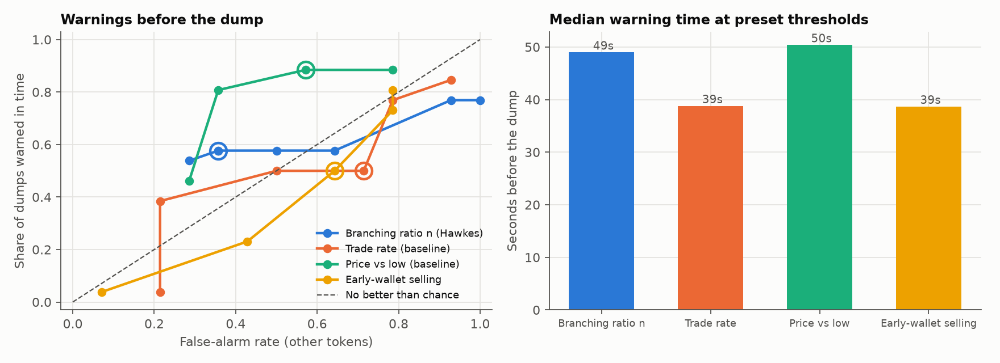

# Results

## Stage 4: excitation by token type (descriptive)

Generated by `scripts/fit_sample.py`. 34 tokens with at least 100 trades; 25 had enough early *and* ordinary trades for the two-type model.

**These numbers use each token's whole first hour, including trades after any dump, so they describe differences between token types. They are not evidence of prediction (that's Stage 5).**

| Measure | Pump-and-dump tokens | Median | Other tokens | Median | Mann-Whitney p |
|---|---|---|---|---|---|
| n | 26 | 0.964 | 8 | 0.864 | 0.270 |
| early_to_ordinary | 20 | 0.400 | 5 | 0.354 | 0.717 |
| ordinary_to_ordinary | 20 | 0.824 | 5 | 0.808 | 0.921 |
| spectral_radius | 20 | 0.965 | 5 | 0.864 | 0.303 |

- Tokens whose early→ordinary estimate clears the noise bar (0.121): 20 of 25.
- Two-type model passes the fit check (KS p > 0.05 for both types): 8% of tokens.
- Univariate model passes the fit check: 26% of tokens.
- Robustness (median early→ordinary): 5 slots 0.372, 2 slots 0.921, 10 slots 0.357, heavy wallets removed 0.394.

## Stage 5: early-warning test

Generated by `scripts/early_warning.py`, design fixed beforehand (decision #27). 26 pump-and-dumps and 14 other tokens. Signals use only past trades, every 5 trades, over the last 30 trades.

**Base rate:** 65% of tokens are pump-and-dumps, so alarming on every token gives 65% precision. A signal is only useful if it beats that *and* the baselines.

### At the preset thresholds (95% confidence intervals in brackets)
| Signal | Threshold | Dumps warned in time | False-alarm rate | Precision | Warned too late | Median lead (s) |
|---|---|---|---|---|---|---|
| Branching ratio n (Hawkes) | 0.9 | 58% (39%–74%) | 36% (16%–61%) | 75% | 6 | 49 |
| Trade rate (baseline) | 2.0 | 50% (32%–68%) | 71% (45%–88%) | 57% | 4 | 39 |
| Price vs low (baseline) | 1.5 | 88% (71%–96%) | 57% (33%–79%) | 74% | 3 | 50 |
| Early-wallet selling | 0.2 | 50% (32%–68%) | 64% (39%–84%) | 59% | 2 | 39 |

### Every threshold tried
| Signal | Threshold | Dumps warned in time | False-alarm rate | Precision | Warned too late | Median lead (s) |
|---|---|---|---|---|---|---|
| Branching ratio n (Hawkes) | 0.3 | 77% | 100% | 59% | 6 | 51 |
| Branching ratio n (Hawkes) | 0.5 | 77% | 93% | 61% | 6 | 50 |
| Branching ratio n (Hawkes) | 0.7 | 58% | 64% | 62% | 7 | 57 |
| Branching ratio n (Hawkes) | 0.8 | 58% | 50% | 68% | 7 | 49 |
| Branching ratio n (Hawkes) | 0.9 | 58% | 36% | 75% | 6 | 49 |
| Branching ratio n (Hawkes) | 0.95 | 58% | 36% | 75% | 6 | 49 |
| Branching ratio n (Hawkes) | 0.99 | 54% | 29% | 78% | 6 | 53 |
| Trade rate (baseline) | 0.5 | 85% | 93% | 63% | 3 | 44 |
| Trade rate (baseline) | 1.0 | 77% | 79% | 65% | 3 | 35 |
| Trade rate (baseline) | 2.0 | 50% | 71% | 57% | 4 | 39 |
| Trade rate (baseline) | 5.0 | 50% | 50% | 65% | 0 | 39 |
| Trade rate (baseline) | 10.0 | 38% | 21% | 77% | 0 | 42 |
| Trade rate (baseline) | 20.0 | 4% | 21% | 25% | 0 | 39 |
| Price vs low (baseline) | 1.25 | 88% | 79% | 68% | 3 | 50 |
| Price vs low (baseline) | 1.5 | 88% | 57% | 74% | 3 | 50 |
| Price vs low (baseline) | 2.0 | 81% | 36% | 81% | 3 | 50 |
| Price vs low (baseline) | 3.0 | 46% | 29% | 75% | 4 | 37 |
| Early-wallet selling | 0.05 | 81% | 79% | 66% | 1 | 39 |
| Early-wallet selling | 0.1 | 73% | 79% | 63% | 1 | 48 |
| Early-wallet selling | 0.2 | 50% | 64% | 59% | 2 | 39 |
| Early-wallet selling | 0.3 | 23% | 43% | 50% | 3 | 37 |
| Early-wallet selling | 0.5 | 4% | 7% | 50% | 3 | 155 |

**How noisy is n from 30 trades?** (simulation) true n = 0.3: average estimate 0.32, middle 80% between 0.03 and 1.00; true n = 0.8: average estimate 0.72, middle 80% between 0.43 and 1.00.

