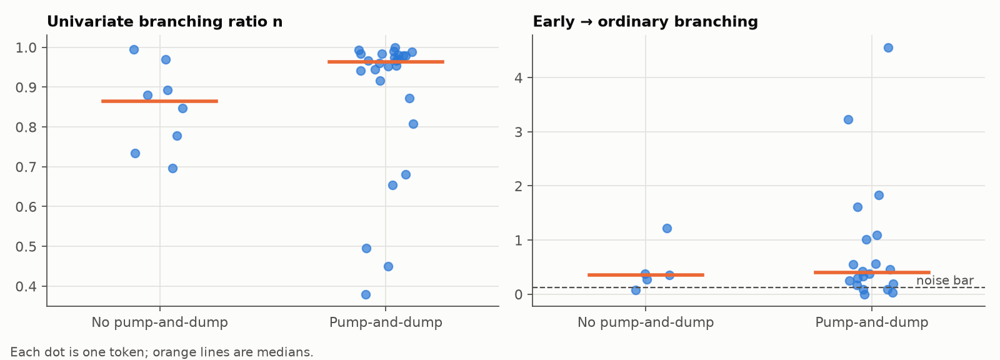

# Results

## Stage 4: excitation by token type (descriptive)

Generated by `scripts/fit_sample.py`. 34 tokens with at least 100 trades; 25 had enough early *and* ordinary trades for the two-type model.

**These numbers use each token's whole first hour, including trades after any dump, so they describe differences between token types. They are not evidence of prediction (that's Stage 5).**

| Measure | Pump-and-dump tokens | Median | Other tokens | Median | Mann-Whitney p |
|---|---|---|---|---|---|
| n | 26 | 0.964 | 8 | 0.864 | 0.270 |
| early_to_ordinary | 20 | 0.400 | 5 | 0.354 | 0.717 |
| ordinary_to_ordinary | 20 | 0.824 | 5 | 0.808 | 0.921 |
| spectral_radius | 20 | 0.965 | 5 | 0.864 | 0.303 |

- Tokens whose early→ordinary estimate clears the noise bar (0.121): 20 of 25.
- Two-type model passes the fit check (KS p > 0.05 for both types): 8% of tokens.
- Univariate model passes the fit check: 26% of tokens.
- Robustness (median early→ordinary): 5 slots 0.372, 2 slots 0.921, 10 slots 0.357, heavy wallets removed 0.394.

