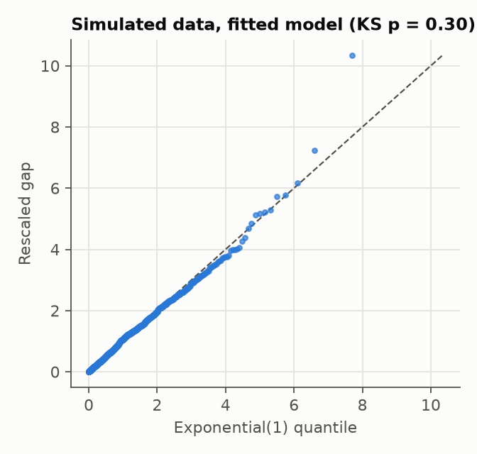

# Validation on simulated data

Generated by `scripts/validate_univariate.py` (100 simulations per scenario, seed 2026).
Each row: the true value, the average estimate, the bias (average minus truth) and the spread (standard deviation across simulations).

| Scenario | Parameter | True | Mean estimate | Bias | Spread |
|---|---|---|---|---|---|
| moderate excitation, ~1,000 events | mu | 0.60 | 0.597 | -0.003 | 0.040 |
| moderate excitation, ~1,000 events | beta | 2.00 | 2.031 | +0.031 | 0.329 |
| moderate excitation, ~1,000 events | n | 0.40 | 0.404 | +0.004 | 0.038 |
| strong excitation, ~1,000 events | mu | 0.20 | 0.201 | +0.001 | 0.017 |
| strong excitation, ~1,000 events | beta | 2.00 | 2.009 | +0.009 | 0.138 |
| strong excitation, ~1,000 events | n | 0.80 | 0.798 | -0.002 | 0.033 |
| strong excitation, ~300 events | mu | 0.20 | 0.197 | -0.003 | 0.030 |
| strong excitation, ~300 events | beta | 2.00 | 2.011 | +0.011 | 0.269 |
| strong excitation, ~300 events | n | 0.80 | 0.787 | -0.013 | 0.061 |

