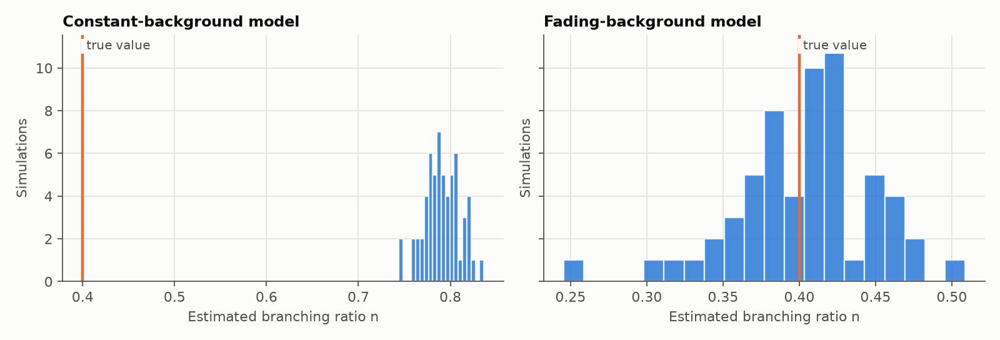

# Validation: launch burst vs self-excitation

Generated by `scripts/validate_fading.py` (60 simulations, seed 2026). Each history has a launch burst fading with half-life 69 s on top of self-excitation with **true n = 0.4**, about 754 events each.

| Model | Mean estimated n | Spread | Passes fit check |
|---|---|---|---|
| Constant background (Stages 3–4) | 0.791 | 0.019 | 68% |
| Fading background (Stage 5b) | 0.404 | 0.045 | 100% |

