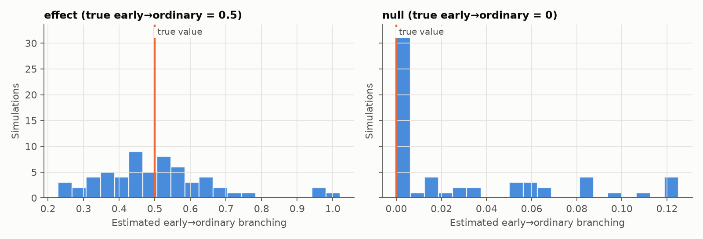

# Validation of the two-type model

Generated by `scripts/validate_multivariate.py` (60 simulations per scenario, seed 2026), at token-like sizes: a few dozen early-wallet trades and a few hundred ordinary ones.

| Scenario | Early trades (avg) | Ordinary trades (avg) | True | Mean estimate | Spread | 95th percentile |
|---|---|---|---|---|---|---|
| effect (true early→ordinary = 0.5) | 42 | 289 | 0.50 | 0.505 | 0.163 | 0.778 |
| null (true early→ordinary = 0) | 45 | 245 | 0.00 | 0.029 | 0.039 | 0.121 |

The null row's 95th percentile is the bar a single token's estimate must clear before we read it as more than noise.

